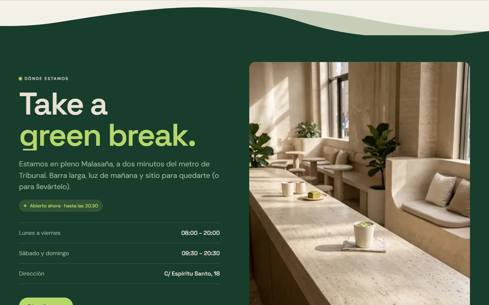
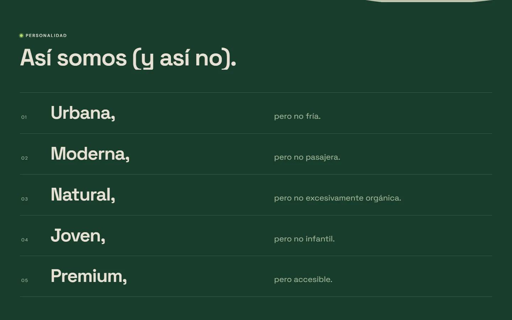
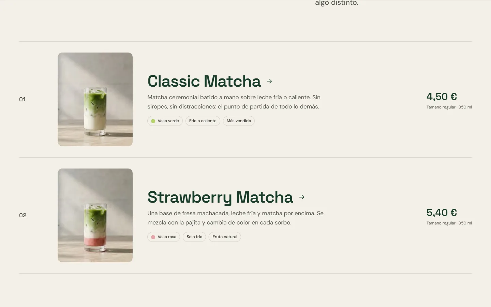
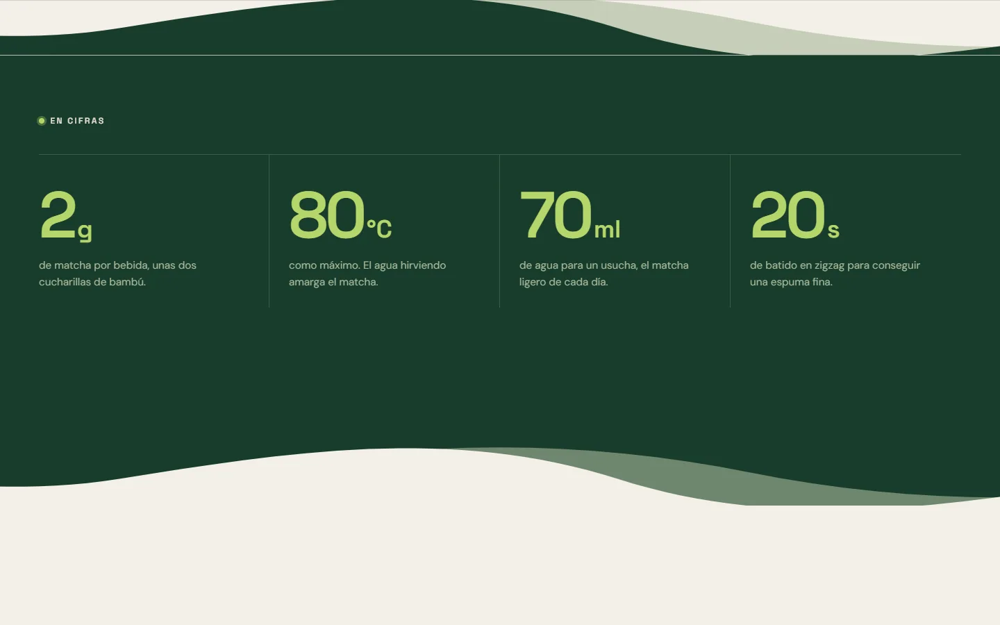
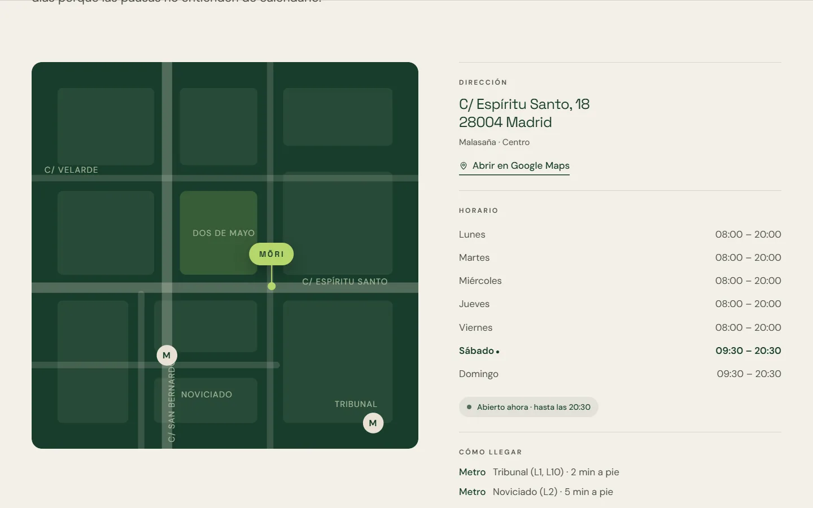
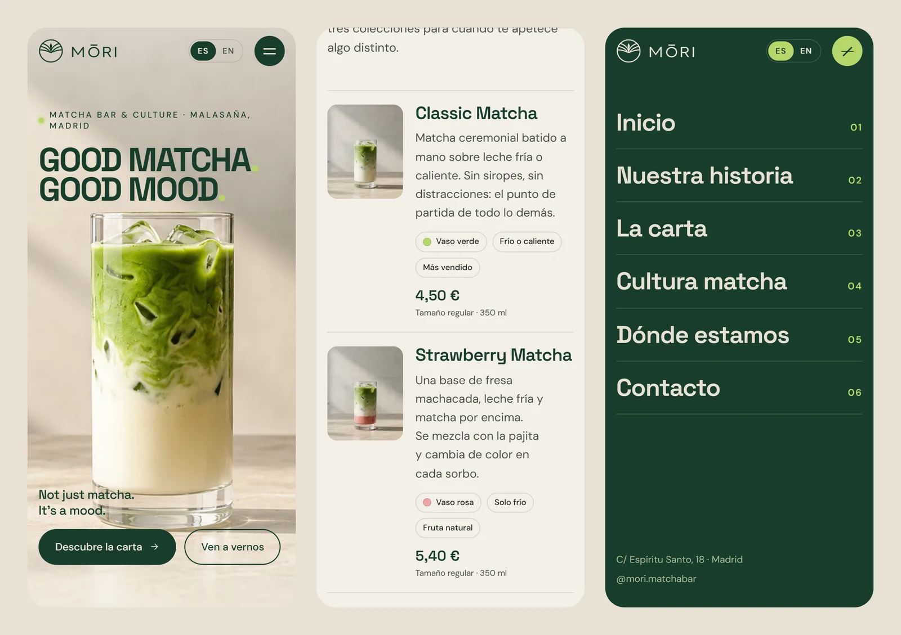
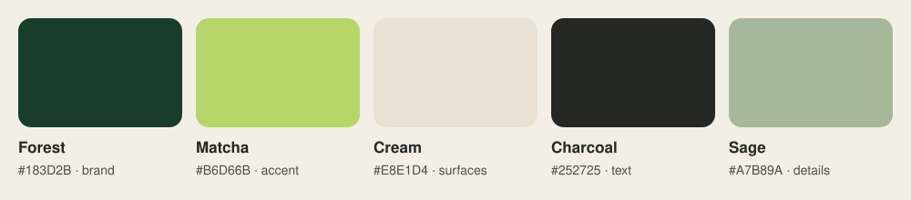

# MŌRI — Matcha Bar & Culture

[English](README.md) | **Español**

**Not just matcha. It's a mood.**

MŌRI es un matcha bar urbano ficticio en Malasaña, Madrid. Este proyecto es la web de la marca, diseñada y desarrollada desde cero como caso de estudio de diseño de interfaz, de marca y de motion: identidad, dirección de arte editorial, narrativa con scroll y accesibilidad, todo en una web estática que carga rápido.

**Web:** [mori-matcha-bar.vercel.app](https://mori-matcha-bar.vercel.app)


## Capturas

| Colección con scroll horizontal fijado                                                                                                    | Sección de visita                                                                                                |
| ----------------------------------------------------------------------------------------------------------------------------------------- | ---------------------------------------------------------------------------------------------------------------- |
|  |  |

| Personalidad de marca                                                                                           | Carta                                                                                  |
| --------------------------------------------------------------------------------------------------------------- | -------------------------------------------------------------------------------------- |
|  |  |

| Cultura matcha                                                                               | Dónde estamos                                                                  |
| -------------------------------------------------------------------------------------------- | ------------------------------------------------------------------------------ |
|  |  |



## Diseño

### Concepto

Las marcas de matcha suelen ir por uno de dos caminos: solemne y ceremonial, o pastel y delicado. MŌRI evita los dos. El objetivo era una marca urbana y fresca que convierta el matcha en un pequeño ritual diario y funcione igual de bien en una fachada de Madrid, en un vaso para llevar y en un perfil de Instagram.

La personalidad de marca se define en pares: urbana pero no fría, moderna pero no pasajera, natural pero no excesivamente orgánica, joven pero no infantil, premium pero accesible.

### Identidad visual



- **Color:** un verde bosque profundo sostiene la marca, con un único acento matcha ácido reservado para destacados, llamadas a la acción y datos. Los fondos crema y papel recogen el travertino de la fotografía.
- **Tipografía:** Space Grotesk para titulares (geométrica, urbana, con interletraje ajustado y mayúsculas en los mensajes grandes) y DM Sans para lectura e interfaz.
- **Logotipo:** un emblema (un brote de té que nace de un cuenco, dentro de un círculo) y el logotipo MŌRI con su macron. Ambos son símbolos vectoriales que toman el color del contexto, así que el mismo logo funciona en verde sobre crema, en crema sobre verde y dentro de las ilustraciones de los vasos.
- **Sistema de color de vasos:** cada bebida de la colección tiene su propio color de vaso. Aparece como un círculo de color en tarjetas, etiquetas y en la página de historia.
- **Dirección de arte:** luz natural cálida, texturas de piedra y travertino, y fotografía de producto con mucho aire alrededor. Las imágenes entran con un recorte que se abre y se mueven con un parallax suave.

### Motion

El movimiento marca el ritmo de la historia, no la decora:

- El titular del hero sube línea a línea y sus dos líneas se separan al hacer scroll.
- El texto de introducción se colorea palabra a palabra al entrar en pantalla.
- En escritorio, la colección de bebidas se fija y avanza en horizontal, con barra de progreso.
- Olas líquidas entre secciones, una cinta de eslóganes, una insignia giratoria «Take a green break», botones magnéticos y un logotipo en el pie que se rellena de verde matcha al llegar al final.
- Los cambios de página usan las transiciones de vista nativas del navegador.

Las animaciones de entrada de la primera pantalla funcionan con CSS, así que nunca retrasan el contenido. Con la opción «reducir movimiento» activada se desactivan el scroll suave, el parallax y los efectos ligados al scroll.

### Contenido

- Totalmente bilingüe: español en `/` e inglés en `/en/`, con URL traducidas (`/carta/` y `/en/menu/`) y un selector de idioma que mantiene la misma página.
- Los eslóganes se mantienen en inglés a propósito, como parte de la voz de la marca.
- Indicador de «abierto ahora» calculado con la hora de Madrid y el día de hoy resaltado en el horario.

## Accesibilidad

- Landmarks semánticos, enlace para saltar al contenido, un solo `h1` por página, y `lang`/`hreflang` en todas las rutas.
- Foco visible en todos los elementos. El menú móvil retiene el foco, deja la página de detrás `inert` y se cierra con Escape.
- El formulario de contacto tiene etiquetas asociadas, `aria-invalid`, mensajes de error en línea y una región de estado anunciada. Es un formulario de demostración y no envía datos.
- La cinta de eslóganes se puede pausar, y todas las combinaciones de color cumplen el contraste WCAG AA.

## Rendimiento

Lighthouse (móvil, build de producción, medido en local):

| Página         | Rendimiento | Accesibilidad | Buenas prácticas |
| -------------- | ----------- | ------------- | ---------------- |
| Inicio         | 93          | 100           | 100              |
| Historia       | 92          | 100           | 100              |
| Carta          | 92          | 100           | 100              |
| Cultura matcha | 91          | 100           | 100              |
| Dónde estamos  | 96          | 100           | 100              |
| Contacto       | 94          | 100           | 100              |

Lo que la hace rápida:

- Cada página de marca es un Server Component generado de forma estática.
- Las animaciones de entrada de la primera pantalla van en CSS, así que nunca esperan al JavaScript.
- GSAP y Lenis se cargan cuando el navegador está libre.
- El CSS va incrustado en cada página.
- `next/image` sirve AVIF y WebP, y `next/font` aloja y precarga las fuentes.

## Arquitectura

El código sigue clean architecture: las dependencias solo apuntan hacia dentro, y ESLint (`eslint-plugin-boundaries`) falla si una capa importa otra que no debe.

```
src/
├─ core/
│  ├─ domain/          Reglas puras: dinero, horario, validación del mensaje de contacto, productos
│  └─ application/     Casos de uso (GetMenu, GetStoreInfo, SubmitContactMessage) y sus puertos
├─ infrastructure/     Adaptadores de los puertos (en memoria por ahora, después Supabase y Stripe)
├─ composition/        Construye los casos de uso con sus adaptadores (solo servidor)
├─ app/[locale]/       Rutas de Next.js, metadatos y Server Actions
├─ ui/                 Componentes: marca, motion (GSAP + Lenis), primitivas, SEO
├─ i18n/               Rutas traducidas con next-intl
└─ styles/             Tema de Tailwind 4 con los tokens de marca
messages/              Textos en ES y EN
e2e/                   Tests de Playwright y axe
```

- **Servidor primero:** las páginas y la carga de datos son React Server Components generados al compilar. Solo van al cliente las partes con interacción o movimiento.
- **Mutaciones a través de casos de uso:** el formulario de contacto envía a una Server Action. La acción valida con zod y llama al caso de uso `SubmitContactMessage`, que reutiliza la misma validación de dominio que usa el formulario en el navegador.
- **Mejora progresiva:** todo el contenido está en el HTML. Si el JavaScript falla o se pide reducir el movimiento, todo sigue siendo legible y usable.

## Tests

| Nivel                  | Herramienta       | Qué cubre                                                                                                                                          |
| ---------------------- | ----------------- | -------------------------------------------------------------------------------------------------------------------------------------------------- |
| Dominio y casos de uso | Vitest            | Dinero, horario con hora de Madrid, validación de contacto, casos de uso de la carta y de la tienda (100 % de cobertura obligatoria en el dominio) |
| Extremo a extremo      | Playwright        | Todas las páginas en ES y EN, selector de idioma, navegación en cliente, menú móvil, formulario, 404 y precarga                                    |
| Accesibilidad          | axe en Playwright | WCAG 2.2 AA en todas las páginas y en los dos idiomas                                                                                              |

La integración continua ejecuta formato, lint, tipos, tests unitarios con cobertura y la suite de extremo a extremo en cada push y pull request.

## Stack

[Next.js 16](https://nextjs.org) (App Router, React 19) · TypeScript · [Tailwind CSS 4](https://tailwindcss.com) · [next-intl](https://next-intl.dev) · [GSAP](https://gsap.com) (ScrollTrigger, SplitText) · [Lenis](https://lenis.darkroom.engineering) · zod · Vitest · Playwright · axe · Vercel

## Ejecutarla en local

```bash
npm install
npm run dev
```

| Script              | Qué hace                                                                                          |
| ------------------- | ------------------------------------------------------------------------------------------------- |
| `npm run dev`       | Servidor de desarrollo en `localhost:3000`                                                        |
| `npm run build`     | Build de producción                                                                               |
| `npm run start`     | Sirve la build de producción                                                                      |
| `npm run lint`      | ESLint, con las reglas de arquitectura                                                            |
| `npm run typecheck` | Comprobación de tipos                                                                             |
| `npm run test`      | Tests unitarios (`test:coverage` para la cobertura)                                               |
| `npm run e2e`       | Tests de extremo a extremo y accesibilidad (ejecuta `npm run e2e:install` una vez, tras compilar) |

Requiere Node 22 o superior.

## Despliegue

La web se despliega automáticamente en Vercel. Cada push a `main` publica producción, y cada rama o pull request tiene su propia URL de vista previa.

---

MŌRI es una marca ficticia creada para un portfolio. La dirección, el teléfono, el email y los precios son inventados.
