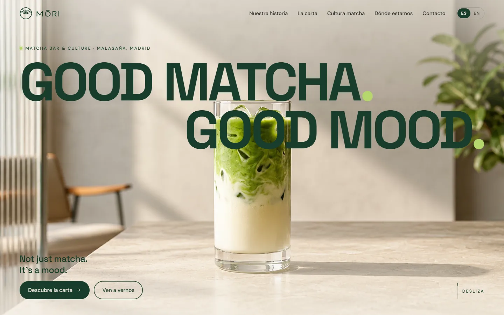
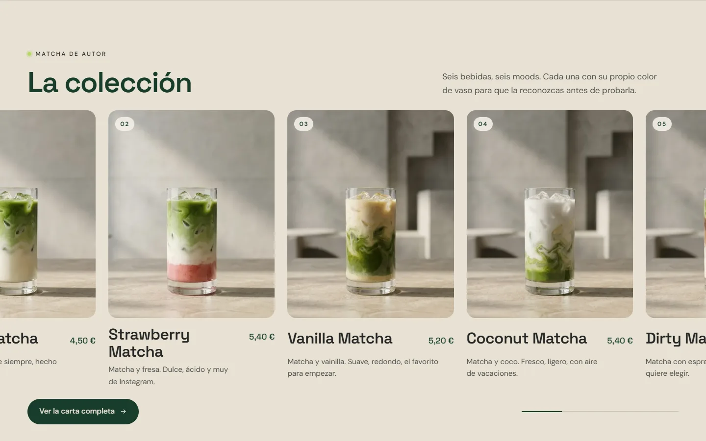
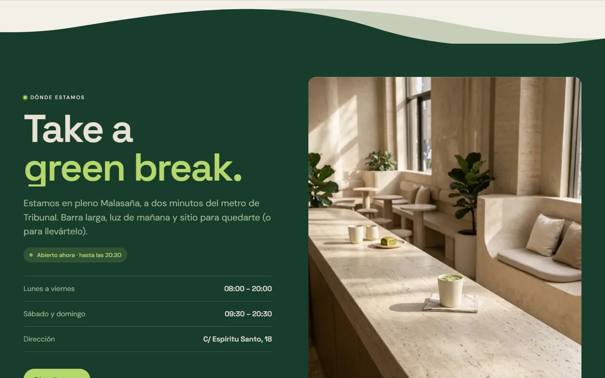
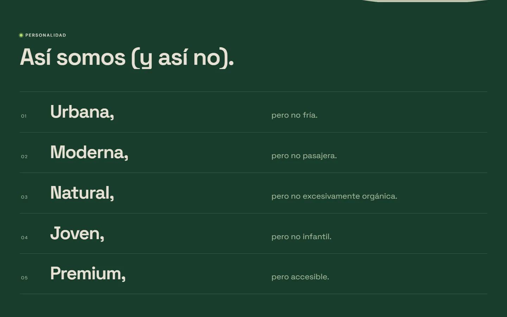
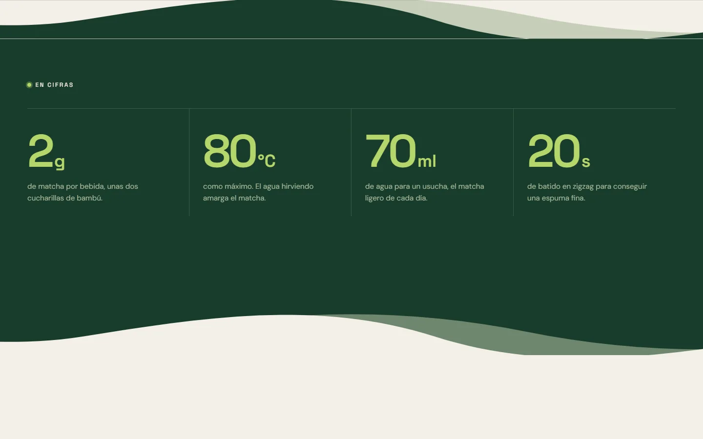
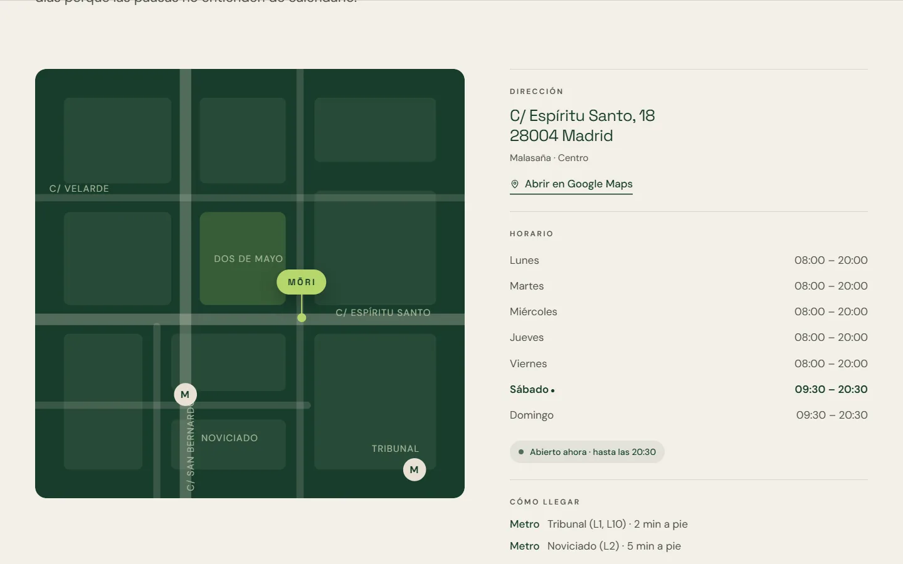
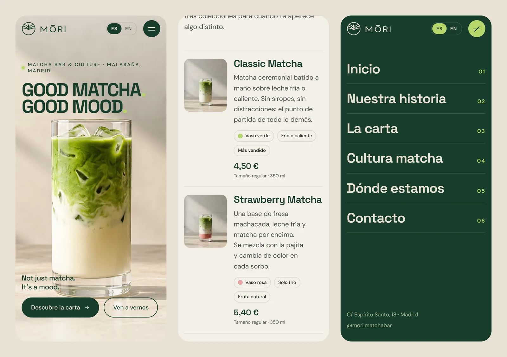

# MŌRI — Matcha Bar & Culture

**English** | [Español](README.es.md)

**Not just matcha. It's a mood.**

MŌRI is a fictional urban matcha bar in Malasaña, Madrid. This project is the brand's website, designed and built from scratch as a UI, brand and motion design case study: identity, editorial art direction, scroll storytelling and accessibility, all in a static site that loads fast.

**Live site:** [mori-matcha-bar.vercel.app](https://mori-matcha-bar.vercel.app)



## Screenshots

| Pinned horizontal collection | Visit section |
| --- | --- |
|  |  |

| Brand personality | Menu |
| --- | --- |
|  |  |

| Matcha culture | Find us |
| --- | --- |
|  |  |



## Design

### Concept

Matcha brands usually go one of two ways: solemn and ceremonial, or pastel and delicate. MŌRI avoids both. The goal was an urban, fresh brand that turns matcha into a small daily ritual, one that would work equally well on a shopfront in Madrid, a takeaway cup and an Instagram grid.

Brand personality, written as pairs: urban but never cold, modern but not a fad, natural but not overly organic, young but not childish, premium but accessible.

### Visual identity


- **Colour:** a deep forest green carries the brand, with a single acid matcha accent reserved for highlights, calls to action and data. Cream and paper backgrounds pick up the travertine of the photography.
- **Type:** Space Grotesk for headlines (geometric, urban, tight tracking, uppercase for the big statements) and DM Sans for reading text and interface.
- **Logo:** an emblem (a tea sprout rising out of a bowl, inside a circle) plus the MŌRI wordmark with its macron. Both are vector symbols that take their colour from the context, so the same logo works in forest on cream, cream on forest and inside the cup illustrations.
- **Cup colour system:** each signature drink has its own cup colour. It shows up as a colour chip in cards, tags and the brand story page.
- **Art direction:** warm natural light, stone and travertine textures, and product photography with a lot of air around it. Images enter with a clip reveal and move with gentle parallax.

### Motion

Motion is used to pace the story, not to decorate it:

- The hero headline rises line by line and the two lines drift apart as you scroll.
- The intro statement fills with colour word by word as it scrolls into view.
- On desktop, the drink collection pins and scrolls horizontally, with a progress bar.
- Liquid wave dividers between sections, a slogan marquee, a rotating "Take a green break" badge, magnetic buttons and a footer wordmark that fills with matcha green as you reach the end.
- Page changes use native cross-document view transitions.

Entrance animations that affect the first screen run in CSS, so they never delay content. With "reduce motion" enabled, smooth scrolling, parallax and scroll-driven effects are switched off.

### Content

- Fully bilingual: Spanish at `/` and English at `/en/`, with localised URLs (`/carta/` and `/en/menu/`) and a language switch that keeps you on the same page.
- Slogans stay in English on purpose, as part of the brand voice.
- A live "open now" badge calculated in Madrid time, and today's row highlighted in the opening hours.

## Accessibility

- Semantic landmarks, a skip link, one `h1` per page, and `lang`/`hreflang` on every route.
- Visible focus states. The mobile menu traps focus, makes the page behind it `inert` and closes with Escape.
- The contact form has associated labels, `aria-invalid`, inline error messages and a live status region. It is a demo form and doesn't send any data.
- The marquee can be paused, and every colour pair meets WCAG AA contrast.

## Performance

Lighthouse (mobile, production build):

| Page | Performance | Accessibility | Best practices | SEO |
| --- | --- | --- | --- | --- |
| Home | 97 | 100 | 100 | 100 |
| Story | 98 | 100 | 100 | 100 |
| Menu | 99 | 100 | 100 | 100 |
| Matcha culture | 96 | 100 | 100 | 100 |
| Find us | 99 | 100 | 100 | 100 |
| Contact | 100 | 100 | 100 | 100 |

What keeps it fast: a fully static output, AVIF/WebP images in several sizes, self-hosted fonts with the two main files preloaded, CSS inlined in each page, and no UI framework shipped to the browser.

## Architecture

```
src/
├─ pages/          Routes: Spanish at the root, English under /en (thin wrappers)
├─ views/          One view per page, rendered for both languages
├─ components/     Header, Footer, PageHero, Marquee, Wave, OpenNow, logo symbols…
├─ layouts/        Base layout: SEO, hreflang, Open Graph, JSON-LD, scripts
├─ i18n/ui.ts      Languages, localised routes and shared interface strings
├─ data/menu.ts    Drinks: prices, cup colours and texts in both languages
├─ scripts/        ui.ts (header, menu, form, opening hours) and motion.ts (GSAP + Lenis)
├─ styles/         Tailwind 4 theme with the brand tokens
└─ assets/         Photography and brand source files
```

- **Static site generation:** Astro renders every page to HTML at build time. There is no server and no client-side framework.
- **Progressive enhancement:** all content is in the HTML. JavaScript only adds behaviour (menu, form validation, opening hours) and motion. If a script fails, content that was waiting for its animation is shown anyway.
- **Content and presentation are separated:** page text lives in each view, keyed by language. Shared strings and routes live in `i18n/`, and product data lives in `data/`.

## Stack

[Astro 7](https://astro.build) · [Tailwind CSS 4](https://tailwindcss.com) · [GSAP](https://gsap.com) (ScrollTrigger, SplitText) · [Lenis](https://lenis.darkroom.engineering) · TypeScript · Fontsource · Vercel

## Running it locally

```bash
npm install
npm run dev
```

| Script | What it does |
| --- | --- |
| `npm run dev` | Development server at `localhost:4321` |
| `npm run build` | Production build in `dist/` |
| `npm run preview` | Serves the production build |
| `npm run check` | Type and template checks |

Node 22 or newer is required.

## Deployment

The site deploys to Vercel automatically. Every push to `main` publishes production, and every other branch or pull request gets its own preview URL.

---

MŌRI is a fictional brand created for a portfolio. The address, phone number, email and prices are made up.
